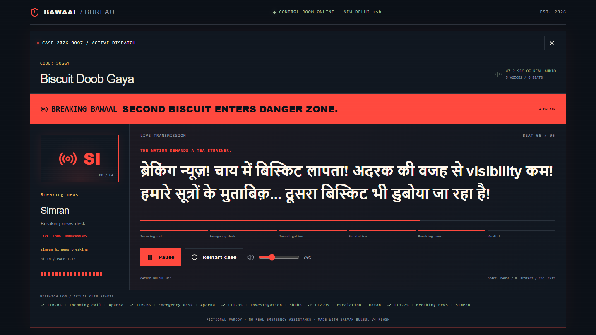
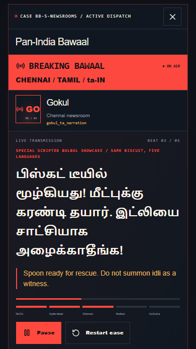

# 🚨 Bawaal Bureau

**Chhoti si problem. National level bawaal.**

Swiggy delivered 12 samosas without green chutney. Your biscuit drowned in chai. Your friend said “bas 5 minute” and has apparently entered another time zone.

Bawaal Bureau is a fictional AI crisis-control room that turns tiny everyday Indian problems into absurd national emergencies. Operators investigate, officers escalate, news anchors lose their composure—and the commissioner delivers a verdict nobody asked for.

Built to explore **Sarvam Bulbul V4 Flash** for the **Sarvam Bulbul Build Challenge**.

## See the bawaal: **[Watch the demo](https://x.com/vishalsingh2972/status/2110414735187624138?s=20)**

<table>
  <tr>
    <td width="70%"></td>
    <td width="30%"></td>
  </tr>
</table>

## What does it do?

Choose a cinematic case—**Biscuit Doob Gaya**, **Bas 5 Minute**, or **Mummy Used My Full Name**—and watch a minor inconvenience become a full departmental operation. These three scripted cases use genuine, pre-generated Bulbul audio for instant playback.

For your own disaster, the **Live AI Desk** uses Sarvam 105B to write fresh, personalized Hindi/Hinglish scenes, then Bulbul voices four officials. The **Pan-India relay** is a separate, fixed five-language biscuit broadcast with pre-generated audio.

## Why it’s fun

- **Speak or type your complaint.** Saaras V4 transcribes your microphone recording; review and edit it before dispatching. Typing works without microphone access.
- **An investigation just for you.** Sarvam 105B turns your complaint into a personalized escalation and ridiculous verdict.
- **Four officials, four performances.** Live scenes move through an operator, investigator, news reporter and commissioner, voiced by genuine Bulbul personas. Preset cases include an additional command officer.
- **Object to the verdict.** Submit one contextual defence by voice or text and hear the commissioner’s response.
- **Escalate across India.** Five fictional regional newsrooms report the same biscuit catastrophe. Large subtitles, animated dispatch screens, progress indicators, pause, volume and replay make the drama easy to follow.

## Five newsrooms. One missing biscuit.

**PAN-INDIA ESCALATION 🌏** sends the incident through:

| Newsroom | Broadcast language |
| --- | --- |
| Delhi | Hindi |
| Hyderabad | Telugu |
| Chennai | Tamil |
| Mumbai | Marathi |
| Kolkata | Bengali |

Each newsroom has a distinct Bulbul V4 Flash persona, native-script captions and a short English translation. The relay ends with a suitably useless national resolution.

This is a **scripted, pre-generated Bulbul showcase**, not automatic translation of custom stories. Live custom scenes currently use Hindi/Hinglish. The app does not offer a custom language selector, streaming, full-duplex conversation or all 11 languages.

## Built with Sarvam

- **Saaras V4:** speech-to-text for complaints and objections.
- **Sarvam 105B Conversations:** personalized dialogue, verdicts and contextual appeals.
- **Bulbul V4 Flash:** expressive, multilingual text-to-speech with distinct character voices.

The interface uses **Next.js App Router, TypeScript, Tailwind CSS and Lucide**, with native browser audio playback. Speech comes from Sarvam—not browser speech synthesis.

```text
Microphone → Saaras V4 → Editable complaint
Typing ───────────────→ Complaint
                            ↓
                     Sarvam 105B
                            ↓
                     Bulbul V4 Flash
                            ↓
                     Cinematic broadcast
                            ↓
            Optional one objection → 105B → Bulbul
```

API requests run through server-side Next.js routes. The browser receives audio and scene data; your Sarvam credential stays on the server.

## Run locally

Requires **Node.js 22.17+** and npm.

1. Install dependencies and create your local environment file:

   ```sh
   npm ci
   cp .env.example .env.local
   ```

   On PowerShell, use `Copy-Item .env.example .env.local`. Skip the copy if `.env.local` already exists. If PowerShell blocks `npm.ps1`, use `npm.cmd` for npm commands.

2. Add your Sarvam key to `.env.local`:

   ```dotenv
   SARVAM_API_KEY=your_key_here
   ```

3. Start the app:

   ```sh
   npm run dev
   ```

   Open [localhost:3000](http://localhost:3000). Restart the server after adding or changing the key.

The included preset cases and relay play **without an API key**. Live generation, microphone transcription, appeals and the Test Bulbul button require a valid key and Sarvam credits. Never commit `.env.local` or give the key a `NEXT_PUBLIC_` prefix.

## Try it

1. Select **Biscuit Doob Gaya** and click **DISPATCH THIS CASE**. Follow the investigation through the breaking-news bulletin and final verdict.
2. Launch **PAN-INDIA ESCALATION 🌏** above the Live AI Desk or from the biscuit verdict. Replay the five-language broadcast.
3. At the Live AI Desk, type a complaint or click **Speak Your Bawaal**, allow microphone access, then **Stop recording**. Review the transcript.
4. Click **Generate my bawaal** and hear your personalized four-character scene.
5. After the verdict, click **OBJECT TO THIS VERDICT 🎙️**, enter a defence and **Submit my one objection**.

Try this complaint:

> Maine Swiggy se 12 samose mangwaye, lekin hari chutney gayab hai!

Then object:

> Chutney optional thi toh tissue kyun bheja? Mere aansu pochhne ke liye?

Live responses vary; these examples are prompts, not canned scripts.

## Development and deployment

```sh
npm run lint
npm run typecheck
npm run build
```

Focused checks: `npm run test:tts`, `npm run test:playback`, `npm run test:crisis` and `npm run test:relay`. To regenerate missing preset and relay clips with your key, run `npm run generate:audio`; existing valid clips are reused.

Deploy to a Node-capable Next.js host with server-side API routes, and set `SARVAM_API_KEY` in its environment for live features. Use HTTPS for microphone access. For a local production run, build first, then run `npm start`.

## Disclaimer

Bawaal Bureau is fictional entertainment and parody, not a government service or real emergency assistance. Included clips are authentic Sarvam-generated audio; live features make paid API calls.

Made with **Sarvam AI · Bulbul V4 Flash** for the **Sarvam Bulbul Build Challenge**.

**Chhoti si problem. National level bawaal.** 🚨
